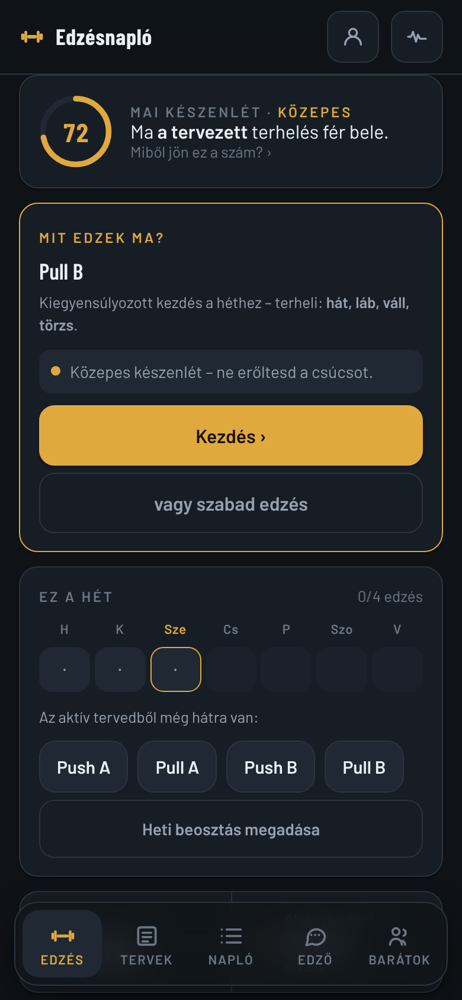
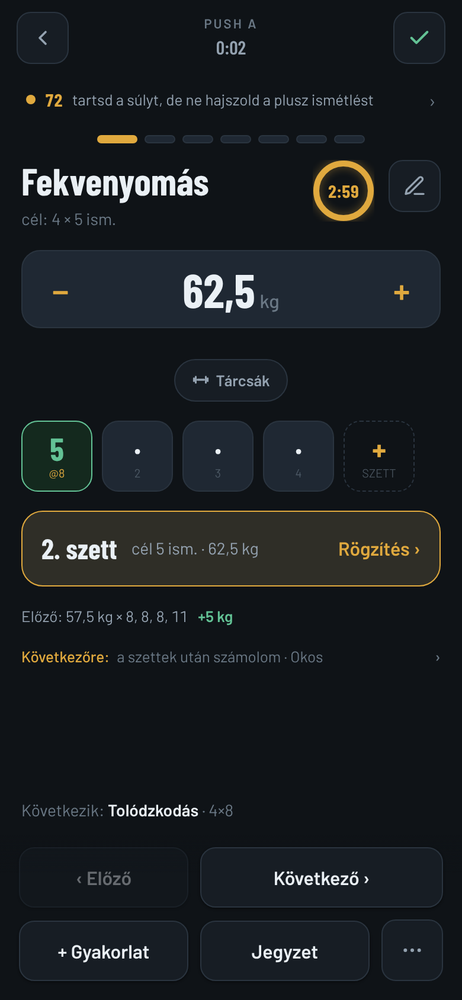
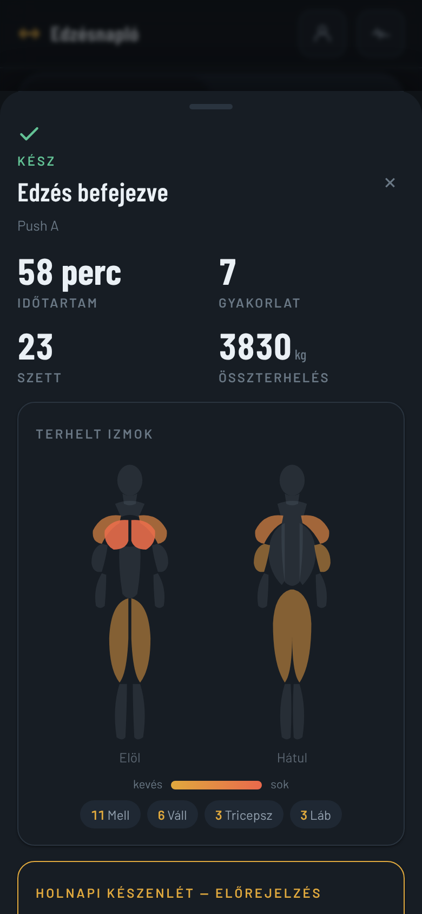

# Edzésnapló

Egykezes, telefonra szánt push/pull edzésnapló – teremben, edzés közben,
izzadt ujjal is kényelmesen használható. A hangsúly a gyorsaságon van: a
szett-rögzítés két koppintás, minden gomb nagy, a súly és az ismétlés
nagy, jól olvasható számokkal jelenik meg.

Build és futásidejű függőség nélküli statikus webapp (`index.html` + `js/`).
Telepíthető PWA, offline is működik, és opcionálisan felhő-fiókkal több
eszköz közt szinkronizál.

**Élő verzió:** https://albi012.github.io/spartaiak/

## Képernyőképek

<table>
  <tr>
    <td align="center" width="33%"><br><sub>Kezdőlap – készenlét és „Mit edzek ma?"</sub></td>
    <td align="center" width="33%"><br><sub>Edzés közben – RPE-vel rögzített szett</sub></td>
    <td align="center" width="33%"><br><sub>Összegző izomtérképpel</sub></td>
  </tr>
</table>

---

## Mit tud

**Kezdőlap**
- **Készenlét-pontszám** (0–100): az alvásból, a heti terhelésből és a
  testsúly-trendből számolva – csak a ténylegesen rögzített adatból, nem tippel.
- **„Mit edzek ma?"** – egy ajánlás egy „Kezdés" gombbal, a heti beosztás
  vagy a héten kimaradt izomcsoportok alapján; mellette szabad edzés.
- Heti nézet (hétfőtől), opcionális nap → hétköznap beosztással.
- Napi testsúly és alvás egy kártyán, trend-grafikonnal.

**Edzés közben**
- Vezetett lejátszó: a soron következő szett egy nagy gomb, a rögzítés két
  koppintás. A fejlécben az edzés eltelt ideje, az „Előző" sor mellett a
  súly-különbség a múltkorihoz képest.
- **RPE** (érzékelt nehézség) opcionálisan – a szám előtt vagy utólag, egy
  koppintással. **Dropset** a fő szett után, menet közbeni „+ szett",
  kézi súlybevitel, „+ Gyakorlat" bármely edzésbe.
- Pihenő-gyűrű a gyakorlat neve mellett (nem takar el semmit), ébren tartott
  képernyő, opcionális rendszer-értesítés.
- Superset / kör, idő-alapú gyakorlatnál visszaszámláló óra, tárcsa-kalkulátor.
- Minden rögzített szett azonnal mentődik – bezárás után „Folytatás".
- Befejezés-összegző: időtartam, összterhelés, új csúcsok, izomtérkép, és a
  holnapi készenlét előrejelzése.

**Tervek**
- Beépített 4 napos terv (Push A / Pull A / Push B / Pull B), kész sablonok,
  saját gyakorlatok, edzések és több napból álló tervek.
- Gyakorlatonként szett × ismétlés × pihenő × kezdősúly edzésenként.
- Beépített gyakorlat-könyvtár (~160 gyakorlat) technika-animációval és
  videó-linkkel.
- Választható progressziós szabály gyakorlatonként (okos / lineáris /
  greyskull / dupla / fix).

**Edző AI**
- Beépített csevegés és heti értékelés (szerveroldali Claude-hívás, heti
  kérdéslimittel), vagy saját/külső AI-hoz másolható anyag.
- **AI-terv importálása**: a személyre szabott promptra kapott tervet három
  lépésben, szerkeszthető előnézettel alakítja saját tervvé.
- Heti összefoglaló edzőnek: szettek, RPE, jegyzetek, alvás és testsúly,
  választható időszakra.

**Napló és Haladás**
- Hetekre bontott, lenyitható edzés-kártyák; pihenőnapok összevonva.
  Utólagos javítás (súly, szett, RPE, dropset), és **Kuka**: a törölt edzés
  3 napig visszahozható.
- Haladás: becsült 1RM-fejlődés (RPE-tudatosan), munkasúly-trendek, heti
  izomtérkép, stagnálás-felismerés, készenlét- és testsúly-trend, edzésnaptár.

**Egyéb**
- Gyógytorna / mobilitás: testtájankénti 5 perces vezetett rutin
  (*referencia, nem orvosi tanács*). Sérülés-mód.
- Jegyzetek (állandó + aznapi, gyakorlathoz kötve) és gépbeállítás-fotó.
- Opcionális fiók (e-mail vagy Google): veszteségmentes szinkron, barátok
  barát-kóddal, terv-küldés, appon belüli fióktörlés.
- Világos / sötét téma, magyar / angol felület.

---

## Kipróbálás

A leggyorsabb az élő verzió megnyitása telefonon és **hozzáadása a
kezdőképernyőhöz** – onnantól teljes képernyős appként, offline is fut:

https://albi012.github.io/spartaiak/

Helyben egy egyszerű statikus szerverrel is futtatható:

```bash
git clone https://github.com/albi012/spartaiak
cd spartaiak
python3 -m http.server 8000
# majd: http://localhost:8000
```

Nincs telepítendő függőség és nincs build lépés – a repó egy statikus
oldal.

---

## Adat és adatvédelem

- Az edzésadat a **böngésződben** marad (`localStorage`); az app
  alapból semmit nem küld el sehová.
- Nincs benne követés, reklám vagy analitika.
- A Profil → „Adataim" kártyáról egy koppintással exportálható és
  visszaállítható az egész napló JSON-ként.
- A felhő-szinkron opcionális: csak akkor lép működésbe, ha beállítasz egy
  saját [Supabase](https://supabase.com) projektet és bejelentkezel. Az
  adatot ekkor is veszteségmentesen fésüli össze, és a törlés egy másik
  eszközön sem „támad fel".

---

## Hogyan épül fel

- Vanilla JavaScript, keretrendszer nélkül: az `index.html` a váz és a CSS,
  a kód a `js/` alatti klasszikus scriptekben (nincs bundler).
- PWA: `manifest.webmanifest` + `sw.js` service worker az offline
  működéshez; ikonok a kezdőképernyőhöz.
- Opcionális felhő-réteg: `js/auth.js` + Supabase (Auth + Postgres az
  `supabase/` alatti sémákkal). Konfiguráció nélkül az app tisztán
  lokálisan fut.
- Edző AI: Supabase Edge Function (`supabase/functions/coach`), a Claude
  API-kulcs csak szerveroldalon van. Telepítés: `docs/coach-ai.md`.
- Deploy: GitHub Pages (a `main` minden pushnál automatikusan publikál a
  `.github/workflows/pages.yml` révén). A repóban lévő `netlify.toml`
  alternatív Netlify-deployt is lehetővé tesz.
- Tesztek a `test/` alatt: `merge-test.html` (a felhő-összefésülés
  regressziói, böngészőben), és `e2e.mjs` (Playwright – a teljes
  felhasználói folyamat egy fejlécnélküli böngészőben). Részletek:
  `test/README.md`.

Saját felhő-szinkronhoz: futtasd le a `supabase/*.sql` sémákat egy Supabase
projektben, majd másold a `supabase-config.example.js`-t
`supabase-config.js` néven, és töltsd ki a projekt URL-jével és a
böngésző-biztos *publishable* kulccsal. (A titkos `service_role` kulcs soha
ne kerüljön a kódba – a hozzáférést a táblák Row Level Security szabályai
védik.)

---

## Licenc és forrásmegjelölés

Személyes projekt. Ha felhasználnád, nyiss egy issue-t vagy vedd fel a
kapcsolatot a repó tulajdonosával.

**Technika-ábrák.** A `gif/` mappa gyakorlat-animációi a
[Gym visual](https://gymvisual.com/) illusztrációi (© Gym visual), a
[hasaneyldrm/exercises-dataset](https://github.com/hasaneyldrm/exercises-dataset)
gyűjteményből, 64 színre optimalizálva. A forrásmegjelölés az appban is ott
van minden ábra alatt (`gifBox()`), illetve a gyakorlatválasztó lap alján –
**ne vedd ki**. Az ábrák szerzői joga a Gym visualé; ha ezt a projektet
továbbterjeszted vagy kereskedelmi célra használnád, előbb tisztázd velük a
felhasználási feltételeket.
